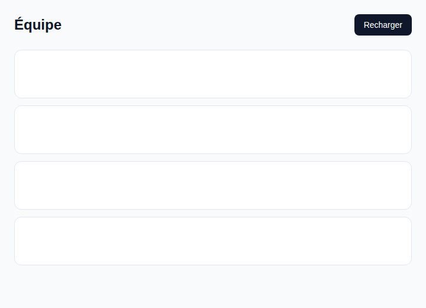
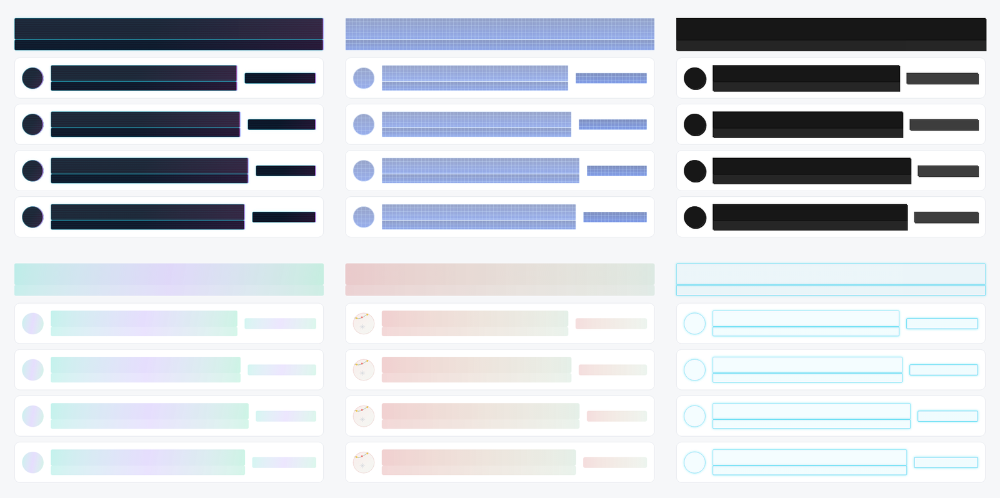

<p align="center">
  <picture>
    <source media="(prefers-color-scheme: dark)" srcset="site/public/brand/readme-dark.svg">
    <source media="(prefers-color-scheme: light)" srcset="site/public/brand/readme-light.svg">
    
  </picture>
</p>

<p align="center">
  Pure CSS skeleton loaders, shaped by your existing page layout.<br>
  Choose the look, the motion and the timing in one configuration file.
</p>

<p align="center">
  <a href="https://techmefr.github.io/charpente/">Documentation</a> ·
  <a href="https://techmefr.github.io/charpente/playground/">Playground</a> ·
  <a href="https://techmefr.github.io/charpente/themes/">38 themes</a> ·
  <a href="https://github.com/techmefr/charpente/blob/main/LICENSE">MIT license</a>
</p>

<p align="center">
  <a href="https://www.npmjs.com/package/charpente"></a>
  
  
</p>

<p align="center">
  
</p>

---

## Why Charpente

- **Shaped by your layout**: skeletons follow your real text, images and buttons, so nothing jumps when data arrives.
- **Pure CSS**: generated at build time, no runtime JavaScript to paint or animate.
- **One config file**: themes, motion and timing, with dark mode and seasonal theming.
- **Accessible by default**: wrappers handle `aria-busy` and `inert` for you.

## What makes it different

Many skeleton libraries ask you to draw placeholder shapes yourself and ship JavaScript to render them. Charpente detects the shapes from your page.

| | Hand-built skeletons | Charpente |
| --- | --- | --- |
| Placeholder shapes | Described or duplicated by hand | Detected automatically from your real layout |
| Runtime cost | JavaScript components | CSS generated at build time |
| Look and feel | Configured per component | One config file, 38 themes |
| Frameworks | Often a single one | Vue, React, Svelte, Solid, Angular, Astro, Blade and vanilla |

<p align="center">
  
</p>

<p align="center"><sub>One layout, six of the 38 themes: cyberpunk, blueprint, brutalist, aurora, christmas, neon.</sub></p>

## Works with your stack

| Framework | Package |
| --- | --- |
| Vue, Nuxt | `charpente-vue` |
| React, Next | `charpente-react` |
| Svelte | `charpente-svelte` |
| Solid | `charpente-solid` |
| Angular | `charpente-angular` |
| Astro | `charpente-astro` |
| Laravel, Livewire | `charpente-blade` |
| Vanilla | `charpente/dom` |

### UI libraries tried

| Library | Example |
| --- | --- |
| Tailwind CSS | [`examples/vanilla`](examples/vanilla) |
| Bootstrap | [`examples/ui-bootstrap`](examples/ui-bootstrap) |
| MUI | [`examples/ui-mui`](examples/ui-mui) |
| shadcn/ui | [`examples/ui-shadcn`](examples/ui-shadcn) |
| Vuetify | [`examples/ui-vuetify`](examples/ui-vuetify) |

Every framework has a working setup in [`examples`](examples). Install works with npm, pnpm and bun.

## Quick start

```sh
pnpm add charpente    # or npm install / yarn add / bun add
```

```ts
// vite.config.ts
import { defineConfig } from vite
import { charpente } from charpente/vite

export default defineConfig({ plugins: [charpente()] })
```

```ts
// entry point
import virtual:charpente.css
```

```html
<section data-charpente-loading aria-busy="true" inert>
  <h2>Team</h2>
  <p>A short introduction to the team.</p>
</section>
```

Remove the attributes when your content is ready.

## Go further

[Installation guide](https://techmefr.github.io/charpente/getting-started/) ·
[Themes](https://techmefr.github.io/charpente/themes/) ·
[Playground](https://techmefr.github.io/charpente/playground/) ·
[Accessibility](https://techmefr.github.io/charpente/accessibility/)

## Contributing

Charpente is young, and feedback is the most useful contribution.

- **Test it and report back**: try it with your framework, UI library or package manager, and [open an issue](https://github.com/techmefr/charpente/issues) with what worked and what did not.
- **Add a theme**: themes live in [`packages/charpente/src`](packages/charpente/src). Try yours in the playground, then open a pull request.
- **Improve it**: fixes, new motions, wrappers for other frameworks and documentation are all welcome.

This repository is a pnpm workspace.

```sh
pnpm install && pnpm build && pnpm test
```

## License

[MIT](LICENSE)
